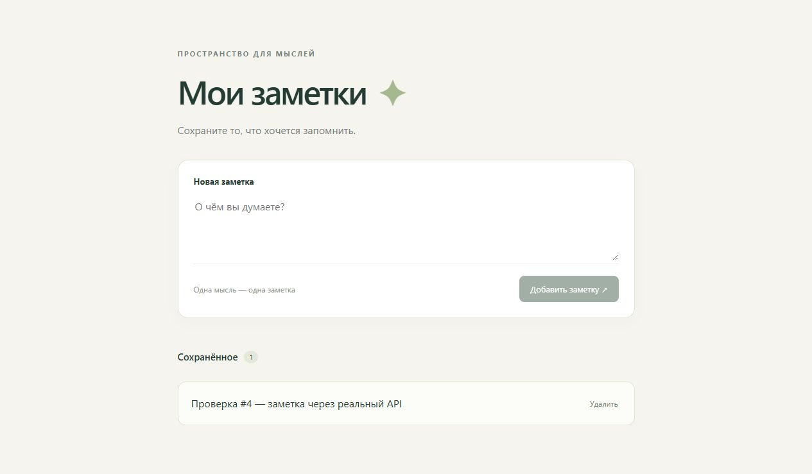

# Проверка #4: добавление заметки через реальный API

Дата: 3 ноября 2026 года. Проверен `main` на коммите
`6e2e9583cc9d862af20f2a7b790bcb60890f8048`, после закрытия зависимостей #2 и #3.
Сервер запущен командой `python server/notes.py`.
Открыт `http://127.0.0.1:8000/` без `?mock=1`; используется реальный API.

| Проверка | Результат |
| --- | --- |
| Пустое поле | Кнопка добавления отключена |
| Поле из трёх пробелов | Кнопка добавления отключена |
| Отправить «Проверка #4 — заметка через реальный API» | Заметка появилась в списке, счётчик 1, поле очищено |
| Перезагрузить страницу | Та же заметка отображается, счётчик 1 |

Журнал сервера подтверждает POST /notes с ответом 201 и GET /notes с ответом 200.
Критерии среза #1 выполнены: отправленная заметка видна после отправки
и перезагрузки страницы; пустой текст отклоняется.

После проверки тестовая заметка удалена через UI.

## Проверка инструкции запуска #9

В новый каталог `.scratch/readme-check` клонирован репозиторий с GitHub.
В нём выполнены `python --version` (3.13.9) и `python server/notes.py`.
Без установки пакетов сервер запустился на порту 8000; браузер загрузил
форму и пустой список через `http://127.0.0.1:8000/`.
Предыдущий экземпляр сервера перед этим остановлен через Ctrl+C.
Код чистого клона соответствует проверенному `main`; изменения README
касаются только описания этих шагов.

Все 23 Python-теста и 4 JavaScript-теста прошли.
