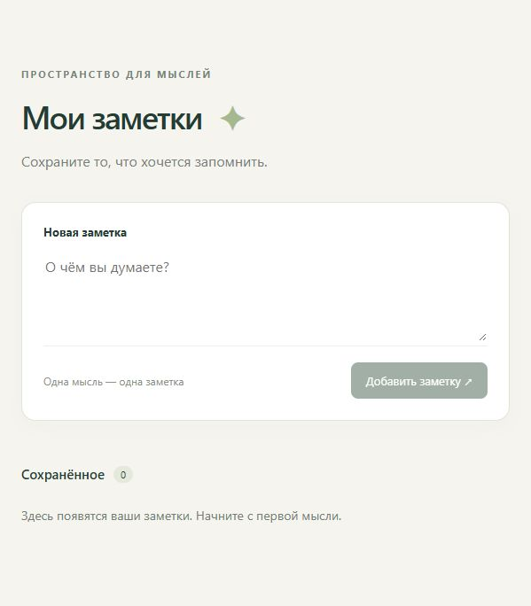

# Проверка #8: удаление заметки через UI

Дата: 3 ноября 2026 года. Сервер: `python server/notes.py`.
Браузер: встроенный браузер Codex, `http://127.0.0.1:8000/`.
Проверялся реальный API, без параметра `mock`.

Проверка выполнена на реализации #3 и #7 в одной ветке перед слиянием.
Тикеты следует закрывать в порядке #3 → #7 → #8.

| Действие | Наблюдаемый результат |
| --- | --- |
| Ввести пробелы | Кнопка добавления отключена |
| Добавить «Проверка #8 — заметка для удаления» | Заметка появилась, счётчик 1 |
| Перезагрузить страницу | Заметка осталась в списке |
| Нажать «Удалить» | Заметка исчезла, счётчик 0 |
| Снова перезагрузить страницу | Список пуст, удалённая заметка не вернулась |
| Добавить «Проверка 404» и открыть вторую вкладку | Обе вкладки показывают заметку |
| Удалить заметку в первой, затем во второй вкладке | Первый DELETE вернул 204, второй 404; обе вкладки показывают пустой список |
| Добавить «Заметка на моках» на `/?mock=1`, затем открыть `/` | Мок работает; реальный список остался пуст |

Ответы 204/404 подтверждены журналом сервера. Тестовые заметки в реальном
API удалены. Итоговый вид после перезагрузки:

Автоматические проверки: 23 Python-теста и 4 теста JavaScript-адаптеров прошли.
Хранилище существующего сервера находится в памяти: сохранность после остановки
процесса не проверялась и не входит в критерий перезагрузки страницы.
